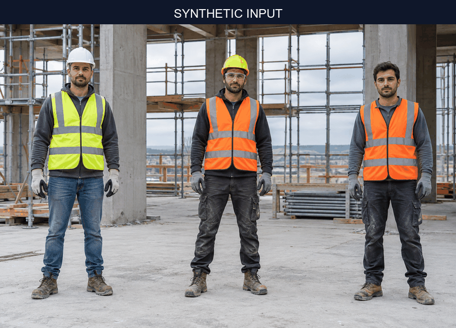
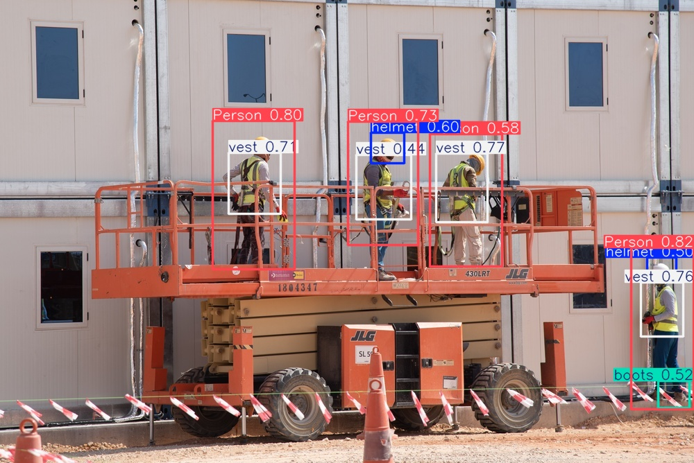
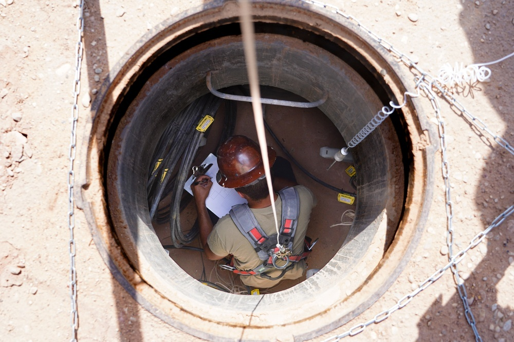
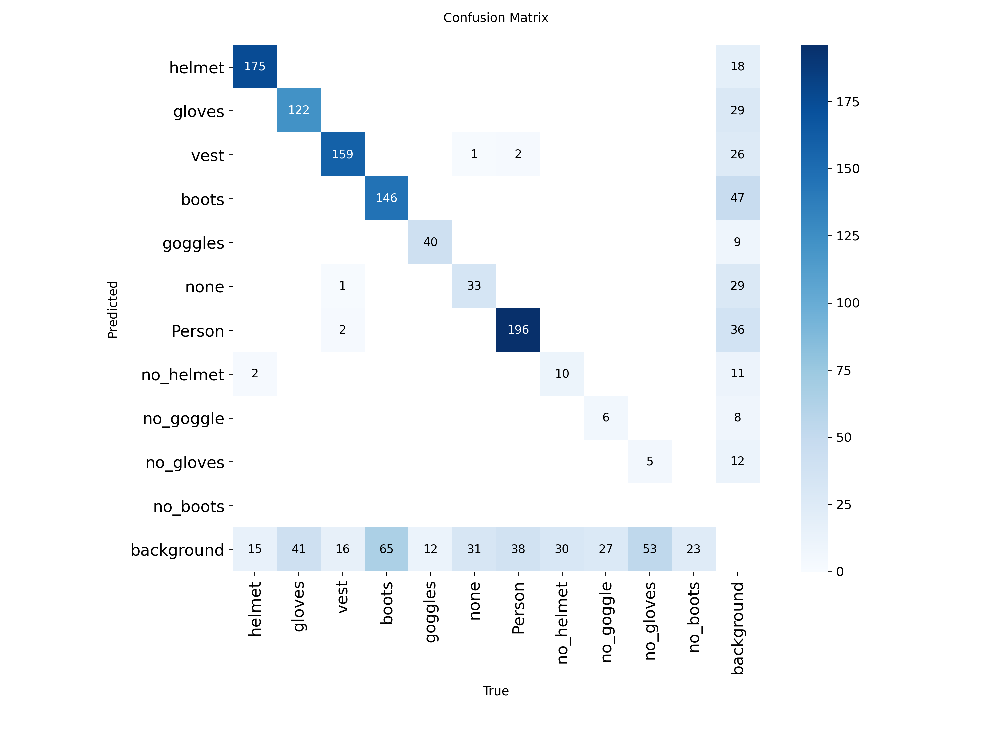
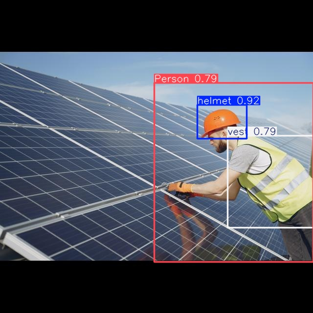
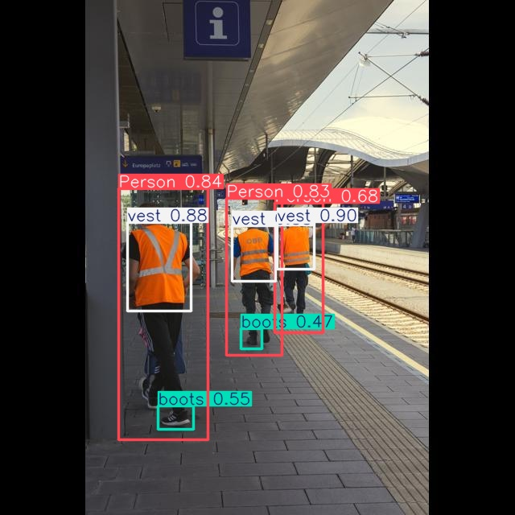
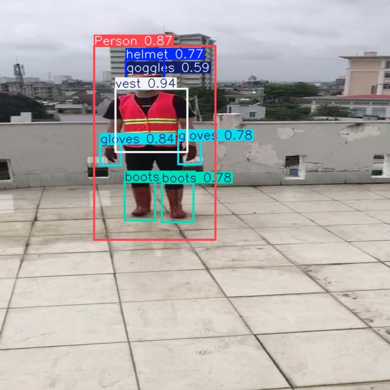
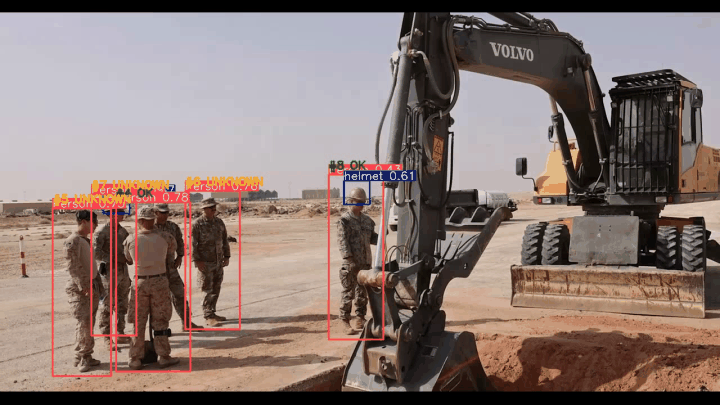

# Construction PPE Detector

A junior-friendly computer-vision project that trains a YOLO model on Google Colab and uses OpenCV
to detect construction workers and personal protective equipment in images and videos.

## Demo



This before/after GIF was produced by the trained model at confidence `0.35`. The included
[`samples/construction-site-synthetic.png`](samples/construction-site-synthetic.png) input is
AI-generated so the project can be tried immediately without publishing private site footage. It is
not part of the dataset or test split and is not presented as evidence of model accuracy.

## What the project demonstrates

- Transfer learning with a pretrained YOLO11n model.
- GPU training in Google Colab.
- A proper train/validation/test workflow.
- Evaluation using Precision, Recall, mAP@0.5, and mAP@0.5:0.95.
- Object detection on images, videos, and a webcam.
- Simple IoU-based person tracking with helmet-status labels in video.
- Exporting a trained model to ONNX.
- Serving image predictions through a small FastAPI service.
- Packaging the API in a non-root Docker container.
- Curating a license-documented Saudi-domain pilot without mixing it into the original benchmark.

The scope is intentionally small enough to explain clearly in a junior-level interview.

## Dataset

The notebook uses the
[Ultralytics Construction-PPE dataset](https://docs.ultralytics.com/datasets/detect/construction-ppe/).
It contains 1,416 images:

| Split | Images |
|---|---:|
| Train | 1,132 |
| Validation | 143 |
| Test | 141 |

Its 11 classes cover people, worn PPE, and some missing-PPE labels. The dataset and trained
Ultralytics weights are AGPL-3.0; review the licence before using them in a commercial product.

### Saudi-domain pilot

[`data/saudi/sources.csv`](data/saudi/sources.csv) records 21 worksite and safety-image sources with
reported Saudi capture locations. After visual review, 15 are approved for the pilot, five are
excluded, and one KAUST source is pending review. The original pages and reuse terms are recorded
before download. Run the manifest-driven downloader with:

```text
python scripts/download_saudi_sources.py --dry-run
python scripts/download_saudi_sources.py
```

Then run the model on the approved images only:

```text
python -m scripts.run_saudi_pilot --device cpu
```

The raw images and full output remain outside Git history. Because most frames come from a few
related galleries, this pilot is for qualitative domain inspection—not a representative Saudi
benchmark and not evidence of accuracy. See [`data/saudi/README.md`](data/saudi/README.md) for the
review, attribution, privacy, and leakage rules. Random Google Images are intentionally excluded
unless their original page supplies explicit reusable rights.

#### Qualitative examples

Both examples below were captured at Prince Sultan Air Base in Saudi Arabia and run through
`best.pt` at confidence `0.35`. In the first image, the model finds four people and four vests but
only two helmets. This is useful evidence that small PPE remains difficult; it is not an accuracy
measurement.



In the second image, the heavily occluded worker inside the manhole receives no detection at all.
Keeping this failure case visible makes the domain limitation clearer than showing only successful
outputs.

**Model output: 0 detections at confidence `0.35`.**



The two source photographs are marked Public Domain on DVIDS; creator, source, modification, and
reuse notes are recorded in [`data/saudi/ATTRIBUTION.md`](data/saudi/ATTRIBUTION.md).

## Train in Google Colab

Open [`notebooks/train_colab.ipynb`](notebooks/train_colab.ipynb) in Colab and select:

```text
Runtime → Change runtime type → GPU
```

Then run all cells. The notebook will:

1. install Ultralytics;
2. download the dataset automatically;
3. fine-tune YOLO11n for up to 40 epochs;
4. evaluate the held-out test split;
5. print Precision, Recall, mAP50, and mAP50-95;
6. count training instances per class;
7. measure fixed confidence operating points at `0.20`, `0.35`, and `0.50`;
8. render six held-out prediction examples;
9. export `best.pt` and `best.onnx`;
10. download the models, metrics, plots, class counts, threshold study, and examples as
   `construction-ppe-results.zip`.

To evaluate the exact checkpoint already used by this repository without retraining, change
`USE_EXISTING_CHECKPOINT` to `True`, run all cells, and upload `models/best.pt` when Colab asks. The
same test metrics, confidence-threshold study, training-label counts, examples, and exports will be
generated against that checkpoint.

## Evaluation summary

The YOLO11n baseline was evaluated on the held-out 141-image test split:

| Metric | Result |
|---|---:|
| Precision | 0.6584 |
| Recall | 0.5312 |
| mAP@0.5 | 0.5572 |
| mAP@0.5:0.95 | 0.2787 |

These values come from [`results/metrics.json`](results/metrics.json). The main weaknesses are
recall and foreground/background separation: the confusion matrix contains 351 missed objects, 225
background false positives, and only eight foreground-class confusions. `no_boots` has zero correct
test matches and is also the smallest training class at 88 of 9,098 instances; the imbalance is a
plausible contributor, not a proven cause.



Fixed-confidence macro results at IoU `0.50` show the operating-point trade-off:

| Confidence | Macro precision | Macro recall | Macro F1 |
|---:|---:|---:|---:|
| 0.20 | 0.6364 | 0.5500 | 0.5448 |
| 0.35 | 0.7402 | 0.4855 | 0.5219 |
| 0.50 | 0.8638 | 0.4505 | 0.5116 |

At `0.20`, recall improves by 6.45 points relative to `0.35` while precision falls by 10.38 points.
That may suit human-reviewed screening, but the demos retain `0.35` for reproducibility. Full
per-class results, class counts, error definitions, and benchmark caveats are consolidated in
[`results/README.md`](results/README.md).

Three of the six held-out qualitative examples are shown below:

| Example 1 | Example 2 | Example 3 |
|---|---|---|
|  |  |  |

## Run locally

Create an environment and install the runtime dependencies.

PowerShell on Windows:

```powershell
python -m venv .venv
.\.venv\Scripts\Activate.ps1
python -m pip install -r requirements.txt
```

Bash on Linux or macOS:

```bash
python3 -m venv .venv
source .venv/bin/activate
python -m pip install -r requirements.txt
```

Download the trained checkpoint from the
[GitHub Releases page](https://github.com/YousefAl0taibi/Construction-Safety-Vision/releases)
and place it at:

```text
models/best.pt
```

Detect objects in an image:

```text
python src/detect.py --model models/best.pt --source samples/construction-site-synthetic.png --output outputs/site-result.jpg
```

To process your own video, first place an authorised clip at `samples/site.mp4`, then run:

```text
python src/detect.py --model models/best.pt --source samples/site.mp4 --output outputs/site-result.mp4 --device 0
```

Use webcam `0` and show the output window:

```text
python src/detect.py --source 0 --output outputs/webcam.mp4 --show
```

For videos and webcam input, the script gives each visible person a temporary tracking ID and adds
one of three heuristic labels: `OK` when helmet evidence is associated with the person's head area,
`NO HELMET` when explicit `no_helmet` evidence is associated with it, or `UNKNOWN` when the model
does not provide clear evidence either way. This is intentionally a simple IoU and spatial-rule
demo, not a safety-certified tracking system. The
[dataset documentation](https://docs.ultralytics.com/datasets/detect/construction-ppe/) describes
`none` only as a generic “Other” class, not as evidence of a missing helmet, so the rule engine
intentionally leaves it as `UNKNOWN` rather than converting it to `NO HELMET`.
A track is retained internally for up to 30 missed frames so a brief detector gap does not
immediately renumber the person; retained tracks are not
reported as current detections. The script also reports the number of frames, average model
inference time, and end-to-end processing FPS. These numbers depend on the machine used.

### Reproducible Saudi video check

[`data/saudi/video_sources.csv`](data/saudi/video_sources.csv) records a 66-second DVIDS B-roll clip
of airfield repair at Prince Sultan Air Base. The source page marks it Public Domain. The pipeline
processes the first 30 seconds; raw and annotated MP4 files remain outside Git history.



The CPU run processed 720 frames at `4.60 FPS` end to end, versus the source's 24 FPS, so it is an
offline demo. The clip primarily shows military personnel in camouflage and soft caps rather than
construction workers consistently wearing hard hats and high-visibility gear. It demonstrates the
complete video pipeline and a domain shift, not construction-site accuracy.

Applying the same helmet rule to the 15 approved Saudi still images gives a useful, but not
controlled, comparison:

| Input | Counting unit | `OK` | `UNKNOWN` | `NO_HELMET` |
|---|---|---:|---:|---:|
| Saudi still images | 75 person detections | 47 (62.7%) | 27 (36.0%) | 1 (1.3%) |
| Airfield-repair video | 951 person-frames | 280 (29.4%) | 671 (70.6%) | 0 (0.0%) |

The counting units differ, so this is qualitative rather than an accuracy comparison. Full
metadata and caveats are in [`results/README.md`](results/README.md).

```text
python scripts/download_saudi_video.py
python -m scripts.run_saudi_video_pilot --device cpu
```

If DVIDS requires sign-in, follow the manual download path in
[`data/saudi/README.md`](data/saudi/README.md).

### Reproducible CPU benchmark

The committed benchmark repeats the included 1536×1024 demonstration image after five warm-up
runs and measures 100 iterations on an AMD Ryzen 5 3500U CPU using four Torch threads:

| Measurement | Mean latency | Throughput |
|---|---:|---:|
| Model inference | 235.7 ms | 4.24 FPS |
| End-to-end in-memory image pipeline | 263.5 ms | 3.79 FPS |

The end-to-end number includes preprocessing, inference, conversion of detections, and annotation;
it excludes disk I/O and video encoding. For a comparable input size, encoded-video throughput is
expected to be lower and is not directly measured here. Recorded run metadata is stored in
[`results/benchmark.json`](results/benchmark.json), and the benchmark can be repeated with:

```text
python -m scripts.benchmark --model models/best.pt --source samples/construction-site-synthetic.png --device cpu --confidence 0.35 --output results/benchmark.json
```

## Deployable demo API

This is a small, deployable demonstration of the trained model—not a production platform. The API
deliberately exposes only three focused endpoints:

```text
GET  /health              service and model readiness
POST /predict             JSON detections for application integration
POST /predict/annotated   annotated JPEG for visual inspection
```

Start it locally:

```text
uvicorn src.api:app --host 0.0.0.0 --port 8000
```

Request JSON detections from PowerShell:

```powershell
curl.exe -F "file=@samples/construction-site-synthetic.png" http://localhost:8000/predict
```

Request an annotated JPEG:

```powershell
curl.exe -F "file=@samples/construction-site-synthetic.png" http://localhost:8000/predict/annotated --output outputs/api-result.jpg
```

On Linux or macOS, use `curl` instead of `curl.exe`. Configuration is supplied through environment
variables:

| Variable | Default | Purpose |
|---|---|---|
| `MODEL_PATH` | `models/best.pt` | Trained checkpoint location |
| `CONFIDENCE` | `0.35` | Detection confidence threshold |
| `DEVICE` | `cpu` | `cpu` or an NVIDIA device such as `0` |
| `MAX_UPLOAD_BYTES` | `10485760` | Maximum uploaded image size |

The prediction endpoints accept JPEG, PNG, and WebP images and reject oversized uploads. The
health endpoint loads the model once and returns HTTP `503` when it is missing or cannot be loaded,
so Docker does not report an unusable container as healthy.

## Docker

The model is mounted at runtime so it is not baked into the public image:

The following commands are each a single line and work in both PowerShell and Bash:

```text
docker build -t construction-ppe-detector .
docker run --rm -p 8000:8000 -v "${PWD}/models:/app/models:ro" construction-ppe-detector
```

The container runs as a non-root user and includes a health check. The default image is CPU-based;
GPU container deployment is intentionally left outside this junior project.

## Scope boundary

Included because it demonstrates that the model can leave the notebook:

- one inference contract, with JSON and annotated-image representations;
- input validation and environment-based configuration;
- a model-loading health endpoint, focused API and tracking tests, and a Docker image.

Explicitly out of scope:

- authentication, user accounts, or a database;
- queues, distributed workers, Kubernetes, or autoscaling;
- monitoring dashboards, alerting, or an SLA;
- automatic retraining or model registries.

Those are product/platform concerns and would distract from the computer-vision learning goal.

## Tests

Focused tests cover model warmup, readiness, upload validation, the JSON response contract,
geometry, tracking, helmet association, output-path safety, video resource cleanup, and validation
of the Saudi image/video manifests and downloader helpers:

```text
python -m pip install -r requirements-dev.txt
python -m pytest -q
```

## Key project structure (abridged)

```text
Construction-Safety-Vision/
├── notebooks/train_colab.ipynb   # train, evaluate, and export
├── src/                          # detector, CLI, tracking, and API
├── scripts/                      # benchmarks and Saudi pilot workflows
├── data/saudi/                   # source manifests and attribution
├── results/                      # metrics, analysis, and checksums
├── docs/images/                  # committed visual evidence
├── samples/                      # runnable synthetic input
├── tests/                        # focused unit and integration tests
├── models/README.md              # release download instructions
└── Dockerfile                    # CPU API image
```

## Limitations

- Accuracy can decrease for distant workers, poor lighting, or unusual camera angles.
- The public dataset may not represent a specific real construction site.
- Predictions are not a replacement for a qualified safety officer.
- A confidence threshold must be validated for the target environment.

## License

This project is released under the [GNU AGPL-3.0](LICENSE). It uses Ultralytics software and models,
as well as the AGPL-3.0 Construction-PPE dataset. Under Ultralytics' current licensing guidance,
using its software or trained models requires either complying with AGPL-3.0 for the complete
project, as this repository does, or obtaining an Ultralytics Enterprise license when those
obligations cannot be met—for example, for a proprietary closed-source deployment. Review the
dataset terms separately before commercial use.
